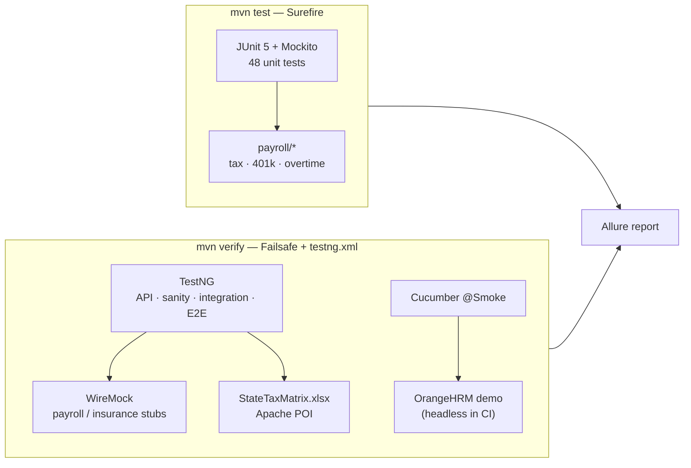

<div align="center">

# 🧾 OrangeHRM Payroll Automation

### HRM + payroll test framework — JUnit 5 unit tests, TestNG API / integration / E2E, Cucumber UI on the OrangeHRM demo

[+limits+%C2%B7+FLSA+overtime;66+%2F+66+tests+passing+in+GitHub+Actions)](https://git.io/typing-svg)

<!-- ============ STATUS BAR ============ -->
[](https://github.com/rbchy/OrangeHRM_TestAutomation_TestNG_Junit5/actions/workflows/ci.yml)


[](TEST_STRATEGY.md)

</div>

---

## 📌 At a Glance

<table>
<tr>
<td width="50%" valign="top">

**🙋 What this is**

A QA framework for a **Human Resource Management and Payroll** system, mapped to a full test taxonomy: unit, API, sanity, integration, end-to-end, data-driven and BDD UI. The UI side runs against the public **[OrangeHRM demo](https://opensource-demo.orangehrmlive.com/)**; the payroll, tax and insurance backend is **stubbed with WireMock**, so every API / integration / E2E test is deterministic.

The payroll rules use **real 2026 regulatory figures** — IRS Publication 15-T brackets, 401(k) limits, FLSA overtime — rather than placeholders.

> *Payroll bugs are paid in real money — the math gets unit tests, the hand-offs get integration tests.*

</td>
<td width="50%" valign="top">

**📍 Quick facts**

| | |
|---|---|
| ✅ **CI** | 66 / 66 on every push |
| 🧮 **Unit** | 48 (JUnit 5 + Mockito) |
| 🔗 **TestNG** | 17 (API · sanity · integration · E2E · data-driven) |
| 🥒 **Cucumber** | 1 smoke login (OrangeHRM demo) |
| 📊 **Data-driven** | 11-state tax matrix from `.xlsx` |
| 📄 **Strategy** | [TEST_STRATEGY.md](TEST_STRATEGY.md) |

</td>
</tr>
</table>

---

## ✅ Latest Results (GitHub Actions)

| Layer | Runs under | Tests | Result |
|---|---|---:|---|
| 🧮 Unit — payroll, tax, 401(k), overtime, insurance, union dues, work hours | `mvn test` (Surefire, JUnit 5) | 48 |  |
| 🔗 TestNG suite — API, sanity, integration, E2E, multi-state tax + Cucumber smoke | `mvn verify` (Failsafe, `testng.xml`) | 18 |  |
| **Total** | | **66** | **100 %** |

<sub>Every push runs `mvn clean verify` ([workflow](.github/workflows/ci.yml)) and uploads the Allure report and raw results. The same 66 / 66 appears in the local Allure exports in this repository ([overview](Allure%20Report%20overview.pdf), [suites](Allure%20Report%20suite.pdf), [behaviors](Allure%20Report%20Behavior.pdf), [packages](Allure%20Report%20Packages.pdf), [graphs](Allure%20Report%20graph.pdf)).</sub>

<details>
<summary><strong>Unit tests by class</strong></summary>

<br>

| Class | Tests | Rule under test |
|---|---:|---|
| `RetirementContributionCalculatorTest` | 10 | 2026 401(k) limits, catch-up / super catch-up, employer match |
| `PayrollCalculatorTest` | 8 | Gross → net with deductions, invalid input |
| `FederalTaxBracketCalculatorTest` | 8 | 2026 IRS Pub 15-T bracket table |
| `OvertimeCalculatorTest` | 7 | FLSA 40-hour week, blended rate for multi-rate weeks |
| `InsurancePremiumCalculatorTest` | 6 | Plan premiums, invalid plan |
| `UnionDuesCalculatorTest` | 5 | Flat-fee and percentage-of-gross dues |
| `WorkHoursValidatorTest` | 4 | Valid vs. invalid hours |

</details>

---

## 🧪 Test Architecture

| Category | How it's covered | Where |
|---|---|---|
| 💨 Smoke | Cucumber `@Smoke` login against the real OrangeHRM demo | `features/Login.feature`, `stepDefinitions/LoginSteps.java` |
| 🩺 Sanity | Fast, narrow post-fix check on one endpoint | `tests/PayStubSanityTest.java` |
| 🔄 Regression | Multi-state tax matrix + API contract checks | `tests/MultiStateTaxTest.java`, `tests/TaxInsuranceApiTest.java`, `tests/InsuranceApiTest.java` |
| ✅ / ❌ Positive & negative | Valid vs. invalid hours and payroll inputs | `unit/WorkHoursValidatorTest.java`, `unit/PayrollCalculatorTest.java` |
| 🧮 Unit | Payroll math isolated with JUnit 5 + Mockito | `src/main/java/payroll/**`, `src/test/java/unit/**` |
| 🔗 Integration | Time-clock export → payroll import hand-off | `tests/TimeClockPayrollIntegrationTest.java` |
| 🔌 API | Status codes + JSON Schema validation (WireMock stubs) | `tests/InsuranceApiTest.java`, `src/test/resources/schemas/` |
| 🚀 End-to-end | Punch → approval → tax deduction → direct deposit | `tests/PayrollE2ETest.java` |
| 📊 Data-driven | 11-state tax matrix read from `.xlsx` with Apache POI | `src/test/resources/testdata/StateTaxMatrix.xlsx` |
| 📱 Mobile (template) | Appium scaffold for geofenced clock-in, excluded from the build | `src/test/java/mobile/ClockInGeofenceMobileTest.java` |
| ⚡ Load (template) | JMeter plan for 50,000 concurrent clock-outs | `performance/PayrollClockOutLoadTest.jmx` |



`mvn test` and `mvn verify` are split on purpose: JUnit 5 and TestNG share the classpath, so Surefire runs only the unit tests and Failsafe runs the TestNG suite with an explicit TestNG provider.

---

## 🛠️ Tech Stack

| Area | Technology |
|---|---|
| Language / build | Java 11+ (CI: Temurin 17) · Maven |
| Unit | JUnit 5.14 · Mockito 5.23 |
| Suite runner | TestNG 7.10 (Failsafe) |
| API | REST Assured 5.4 · JSON Schema Validator · WireMock 3.13 |
| UI / BDD | Selenium 4.22 (Selenium Manager) · Cucumber 7.18 |
| Data | Apache POI 5.2 (`.xlsx`) |
| Mobile / load (templates) | Appium java-client · Apache JMeter |
| Reporting | Allure 2.35 (JUnit 5, TestNG and Cucumber adapters) |
| CI | GitHub Actions |

---

## ⚙️ Running the Suite

**Prerequisites:** JDK 11+ · Maven 3.8+ · Google Chrome (for the Cucumber login)

```bash
git clone https://github.com/rbchy/OrangeHRM_TestAutomation_TestNG_Junit5.git
cd OrangeHRM_TestAutomation_TestNG_Junit5

mvn clean test          # 48 JUnit 5 unit tests only — seconds
mvn clean verify        # unit tests + full TestNG suite + Cucumber smoke
mvn allure:serve        # open the Allure report
```

Chrome runs headless automatically when `CI=true` (GitHub Actions sets it); locally it opens a visible window.

---

## 📁 Project Structure

```
OrangeHRM_TestAutomation_TestNG_Junit5/
├── .github/workflows/ci.yml          ← mvn verify + Allure on every push
├── src/main/java/payroll/            ← tax, 401(k), overtime, insurance, union dues, validation
├── src/test/java/
│   ├── unit/                         ← JUnit 5 + Mockito (Surefire)
│   ├── tests/                        ← TestNG: API, sanity, integration, E2E, multi-state tax
│   ├── stepDefinitions/LoginSteps.java
│   ├── runner/TestRunner.java        ← Cucumber @Smoke
│   └── mobile/                       ← Appium template (not built)
├── src/test/resources/
│   ├── features/                     ← Login.feature (@Smoke), Authentication.feature (draft)
│   ├── schemas/                      ← JSON Schemas for pay stubs and insurance benefits
│   └── testdata/StateTaxMatrix.xlsx
├── performance/PayrollClockOutLoadTest.jmx
├── testng.xml
├── TEST_STRATEGY.md
└── pom.xml
```

---

## 🧹 Maintenance Log

| Change | Why |
|---|---|
| Added `.github/workflows/ci.yml` | The old README showed a CI badge for a placeholder repository (`your-github-username/hrm-payroll-automation`) and a workflow that did not exist |
| Removed 5 empty (0-byte) source files and an empty `cucumber.properties` | `LoginPage`, `PimAddEmployeePage`, `LeaveApplyPage`, `PimEmployeeValidationTest` and `LeaveApplicationTest` reached GitHub empty |
| `testng.xml` no longer lists the PIM / Leave classes | Listing empty classes would make `mvn verify` fail |
| Raw `allure-results/` removed; `.gitignore` added | Build output, regenerated on every run |

---

## 📌 Known Limitations

- **PIM and Leave UI tests are not in the repository.** [TEST_STRATEGY.md](TEST_STRATEGY.md) describes them (including the Leave-entitlement fix), but their source was committed as empty files. Re-committing them from the original machine would restore that coverage.
- **Mobile** and **load** are templates — there is no real mobile app or staging server yet; both stay out of `mvn verify`.
- `tests/TimeClockNegativeTest` is tagged `Flaky` and excluded; the same rule is covered in `unit/WorkHoursValidatorTest`.
- `Authentication.feature` is a draft without step definitions; the runner only picks up `@Smoke`.

---

## 📈 Roadmap

- [x] GitHub Actions running `mvn verify` with Allure artifacts
- [ ] Re-commit the PIM / Leave page objects and tests
- [ ] Step definitions for `Authentication.feature`
- [ ] Publish the Allure report to GitHub Pages
- [ ] Run the JMeter plan against a staging stub in a nightly job

---

## 🔗 Related Projects

| Project | Stack |
|---|---|
| ⭐ [RbcTcsWorld E-Commerce Suite](https://github.com/rbchy/RbcTcsWorld_ECommerceSuite) | Spring Boot · REST Assured · mutation testing · CI quality gates |
| 🧪 [ClinTrial-Connect](https://github.com/rbchy/RbcTcsWorld_ClinTrial-Connect) | Spring Boot · JUnit 5 · Cucumber · JMeter |
| 💼 [Payroll Management System](https://github.com/rbchy/PayrollManagementSystem) | Java Swing · MySQL · JDBC |
| 🏥 [OpenEMR Healthcare](https://github.com/rbchy/OpenEMR_Automation) | Java · Selenium · Cucumber · TestNG — CI green |

<sub>All projects: [github.com/rbchy](https://github.com/rbchy)</sub>

---

## 👤 Author

<div align="center">

**Ranajit Baran Chowdhury (RB Chowdhury)**
QA Automation Engineer / SDET · West Norriton, Pennsylvania, USA

[](https://www.linkedin.com/in/rbchy/)
[](https://github.com/rbchy)
[](https://rbchy.github.io/rbchy/)
[](https://rbc6543.wixsite.com/rbc-portfolio)
[](mailto:chyranajit@gmail.com)

<sub>The OrangeHRM demo is a public, shared instance; the payroll backend is stubbed and contains no real employee data.</sub>

⭐ *If this framework helps you, a star on the repo is appreciated.*

</div>
